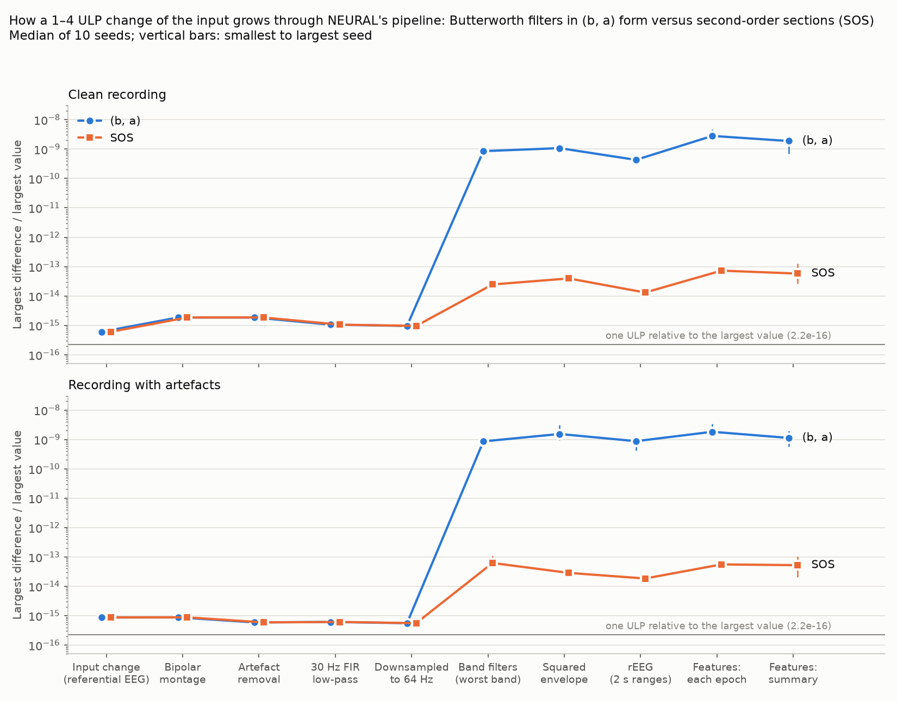

# Numerical sensitivity of NEURAL's Butterworth band filters

A single-machine experiment on the two synthetic recordings of the regression
tests (no real recordings). NEURAL's code was not changed. How to re-run it:
[README.md](README.md). The summary refers to the run recorded below; the
tables, checks and figure are written by `run_sensitivity.py`.

## Summary

- **The largest increase occurs in the Butterworth feature band filters.**
  A 1–4 ULP change of the input (about 5e-16) stays at about 1e-15 through the
  bipolar montage, artefact removal, the 30 Hz low-pass and downsampling. The
  (b, a) band filters then raise it to about 7e-10 in the 0.5–4 Hz band and in
  the FD band (0.5–30 Hz), both of which contain a 0.5 Hz high-pass; to about
  4e-12 in the 13–30 Hz band, whose 30 Hz low-pass is close to the 32 Hz
  Nyquist frequency; and to less than 1e-13 in the other two bands (RMS
  measure, Table A1). Spectral, BSI and coherence features, which do not
  directly use these band filters, changed by at most 2e-14. No artefact
  decision changed in the 40 perturbed whole-pipeline runs in part A.
- **The results are consistent with a rounding-dominated regime.** For a
  1–4 ULP input change the tested 0.5 Hz high-pass gives an output change
  1.6 million times larger than the input change, and 1.5 million times the
  float64 SOS linear-response estimate. For these synthetic inputs and tested
  perturbations, the 0.5–4 Hz band's output change stays near 7e-10 over input
  changes from 1e-15 to 1e-10. This supports filter rounding as a likely cause,
  but does not by itself identify the cause of the cross-machine differences.
  An empirical indicator, 2.2e-16 times the largest gain of the feedback part
  (1/A), is within about 4x for the clean-recording order-5 medians; the
  artefact-recording 13–30 Hz median differs by about 5x. It is not a bound.
  A 1-ULP change of the (b, a) coefficients has an effect of the same size or
  larger (1.5e-9). This does not show that machines used different coefficients.
- **In the features,** per-epoch values changed by up to 3.5e-7 relative where
  they are close to zero (`amplitude_skew` at a value of 0.0012, about 4e-10
  absolute; `rEEG_asymmetry` up to 1.3e-7), and summaries by at most 2.5e-9.
  This is close to the largest difference reported between the GitHub Ubuntu
  runner and the reference PC: 3.2e-7, also for `amplitude_skew` at a value of
  about 0.0012 (about 4e-10 absolute).
- **Second-order sections remove almost all of it.** With SOS the 0.5–4 Hz
  band filter's difference falls from 7e-10 to 1.8e-14 (about 40,000 times
  smaller), and the features' relative differences to at most 8e-12 per epoch
  and 1.3e-13 in the summaries. This describes the combined feature computation
  only; individual downstream stages were not isolated. SOS gives little
  benefit for the tested order-2 0.1 Hz high-pass of the high-amplitude
  artefact check, which is one section in either form.
- **Switching to SOS would change results by the same order as the (b, a)
  form's own sensitivity.** Without any perturbation, the 0.5–4 Hz band output changes
  by 1.3e-9 and the features by up to 5.7e-7 relative per epoch and 3.4e-9 in the
  summaries; spectral, BSI and coherence features and all artefact decisions
  stay exactly the same. Switching to SOS would be a separately reviewable
  numerical change, compared against the unchanged original references using
  both absolute and relative tolerances.
- **Recorded checks:** the repeat-run and original-code byte-identity results
  were recorded during the run. The JSON files are not in the repository.

## Question and approach

Between computing environments the original NEURAL code (commit 78c9425) gives
features that differ by up to about 3e-7 relative, while its preprocessed EEG
differs by only about 1e-14 (reported; see
[docs/REVIEW_NOTES.md](../../docs/REVIEW_NOTES.md)). Only features computed
with `utils.filter_butterworth_withnans` show the larger differences. That
function applies order-5 Butterworth filters (a low-pass, then a high-pass),
designed by `scipy.signal.butter` as (b, a) polynomial coefficients and applied
forwards and backwards by `mfiltfilt.mat_filtfilt`. The hypothesis is that
these (b, a) filters amplify last-digit rounding differences.

The experiment makes a tiny, controlled change, of the size of a rounding
difference, and follows it:

- **A, stage by stage:** every sample of the referential EEG moved by 1–4 units
  in the last place (ULP), then NEURAL's whole pipeline, compared with the
  unperturbed run after each stage (both recordings, 10 seeds each).
- **B, filter only:** the same kind of change fed straight into each
  Butterworth filter of the pipeline and compared with the exact response;
  then input changes from 1e-15 to 1e-8.
- **C, coefficients:** the (b, a) coefficients moved by 1 ULP instead of the
  signal.
- **D, second-order sections (SOS):** the same filters split into second-order
  sections, the form SciPy's documentation recommends for `butter`; A and B
  repeated with them, and the unperturbed SOS results compared with (b, a).

One ULP is the smallest possible change of a stored number, about 2.2e-16 of
its size. Differences are relative to the size of the signal or feature unless
they are called absolute.

<!-- BEGIN GENERATED (written by run_sensitivity.py; edit the script, not this part) -->

## How this run was made

- **Inputs:** the two synthetic recordings of the regression tests (`tests/synthetic_edf.py`), "clean" and "artefacts": 300 s, 256 Hz, 9 electrodes, whole-number samples. Checksums identical to the regression tests' inputs: yes. No real recordings were used.
- **Perturbation (A):** every non-zero sample of the referential EEG moved by 1 to 4 ULP (random number and direction; `np.nextafter`); exact zeros left unchanged. 10 seeds per recording; the same perturbed inputs are used for (b, a) and SOS. One ULP (unit in the last place) is the smallest possible change of a stored number, about 2.2e-16 of its size.
- **Measures:** for signals, max|d| / max|x| (largest difference relative to the largest value) and RMS(d) / RMS(x); for features, the largest relative difference |d| / |x| over all values that are not zero, the largest absolute difference |d|, and max|d| / max|x| per feature. NaN positions are compared separately. "Median (largest)" means the median and the largest value over the seeds.
- **Environment:** Windows-11-10.0.26200-SP0 (AMD64), Python 3.14.7, numpy 2.5.3, SciPy 1.18.1, pandas 3.0.2, MNE 1.13.2, matplotlib 3.11.2.
- **NEURAL code:** this repository (`src/`); 9 of 13 modules are identical to the original commit 78c9425 (changed: `connectivity_features.py`, `generate_all_features.py`, `preprocessing_EEG.py`, `utils.py`, the pandas 3 compatibility changes).

## Checks

| Check | Result |
|---|---|
| The stage-by-stage pipeline gives exactly the output of `preprocessing_EEG.main_preprocessing` | yes |
| Artefact removal only inserts NaN: its output equals the bipolar signal with NaN at the removed samples | yes |
| The recomputed decision quantities (correlations, coupling powers, envelopes) predict NEURAL's removed channels and high-amplitude percentage | yes |
| The filter switch in (b, a) mode changes nothing: features identical to plain NEURAL | yes |
| In SOS mode every Butterworth filter ran in SOS form (no (b, a) filtering left) | yes |
| SOS gives the same artefact decisions as (b, a) | yes |
| SOS gives exactly the same preprocessed EEG as (b, a) | yes |
| Control: the same input run twice gives differences of exactly 0 everywhere | yes |
| The SOS forwards-backwards code gives exactly the output of `scipy.signal.sosfiltfilt` (odd padding, same padding length) | yes |
| Part A in (b, a) form run with the original NEURAL code (all 13 modules identical to 78c9425, pandas 2.3.3, numpy 2.5.3, SciPy 1.18.1): every number, the fingerprint of the unperturbed outputs and every per-seed difference byte for byte identical | yes |

Channels removed by NEURAL: clean none; artefacts C4_Cz, F4_C4.

## A. Where the difference grows: stage by stage

Table A1. RMS(d) / RMS(x) after each stage, median (largest) over 10 seeds. The input change is the first row. Rows from "Band filter" on are computed inside the feature functions, epoch by epoch.

| Stage | clean, (b, a) | clean, SOS | artefacts, (b, a) | artefacts, SOS |
|---|---|---|---|---|
| Referential EEG (the input change) | 4.5e-16 (4.5e-16) | 4.5e-16 (4.5e-16) | 4.2e-16 (4.3e-16) | 4.2e-16 (4.3e-16) |
| Bipolar montage | 1.0e-15 (1.0e-15) | 1.0e-15 (1.0e-15) | 6.0e-16 (6.1e-16) | 6.0e-16 (6.1e-16) |
| After artefact removal | 1.0e-15 (1.0e-15) | 1.0e-15 (1.0e-15) | 7.7e-16 (7.7e-16) | 7.7e-16 (7.7e-16) |
| 30 Hz FIR low-pass (256 Hz) | 5.7e-16 (5.7e-16) | 5.7e-16 (5.7e-16) | 4.2e-16 (4.2e-16) | 4.2e-16 (4.2e-16) |
| Downsampled to 64 Hz (preprocessed EEG) | 5.7e-16 (5.7e-16) | 5.7e-16 (5.7e-16) | 4.2e-16 (4.3e-16) | 4.2e-16 (4.3e-16) |
| Band filter 0.5–4 Hz | 6.9e-10 (7.1e-10) | 1.8e-14 (1.9e-14) | 7.3e-10 (7.7e-10) | 1.8e-14 (1.9e-14) |
| Band filter 4–7 Hz | 7.1e-14 (7.1e-14) | 1.5e-15 (1.5e-15) | 8.3e-14 (8.7e-14) | 2.3e-15 (2.6e-15) |
| Band filter 7–13 Hz | 6.3e-15 (6.4e-15) | 1.0e-15 (1.1e-15) | 6.9e-15 (7.0e-15) | 1.4e-15 (1.5e-15) |
| Band filter 13–30 Hz | 3.6e-12 (3.6e-12) | 5.4e-15 (5.5e-15) | 4.8e-12 (5.4e-12) | 8.5e-15 (8.9e-15) |
| FD band filter 0.5–30 Hz | 7.0e-10 (7.1e-10) | 1.8e-14 (1.8e-14) | 6.9e-10 (7.1e-10) | 1.9e-14 (2.2e-14) |
| Squared envelope, 0.5–4 Hz | 7.1e-10 (7.2e-10) | 2.0e-14 (2.0e-14) | 7.8e-10 (1.0e-9) | 2.0e-14 (2.1e-14) |
| Squared envelope, 4–7 Hz | 8.7e-14 (8.8e-14) | 1.8e-15 (1.8e-15) | 1.0e-13 (1.1e-13) | 2.8e-15 (3.1e-15) |
| Squared envelope, 7–13 Hz | 7.9e-15 (8.0e-15) | 1.2e-15 (1.2e-15) | 8.5e-15 (8.7e-15) | 1.6e-15 (1.7e-15) |
| Squared envelope, 13–30 Hz | 3.6e-12 (3.6e-12) | 5.5e-15 (5.6e-15) | 5.0e-12 (5.7e-12) | 8.6e-15 (9.4e-15) |
| rEEG (2 s ranges), 0.5–4 Hz | 1.8e-10 (1.9e-10) | 6.3e-15 (6.6e-15) | 2.1e-10 (2.4e-10) | 6.4e-15 (6.5e-15) |
| rEEG (2 s ranges), 4–7 Hz | 2.6e-14 (2.7e-14) | 6.8e-16 (7.0e-16) | 3.3e-14 (3.6e-14) | 8.9e-16 (1.1e-15) |
| rEEG (2 s ranges), 7–13 Hz | 2.6e-15 (2.7e-15) | 4.4e-16 (4.5e-16) | 2.9e-15 (3.1e-15) | 5.4e-16 (8.2e-16) |
| rEEG (2 s ranges), 13–30 Hz | 9.7e-13 (1.0e-12) | 1.5e-15 (1.5e-15) | 1.3e-12 (1.5e-12) | 2.2e-15 (2.7e-15) |

Table A1b. The same with max|d| / max|x|

| Stage | clean, (b, a) | clean, SOS | artefacts, (b, a) | artefacts, SOS |
|---|---|---|---|---|
| Referential EEG (the input change) | 6.0e-16 (6.0e-16) | 6.0e-16 (6.0e-16) | 8.7e-16 (8.7e-16) | 8.7e-16 (8.7e-16) |
| Bipolar montage | 1.9e-15 (1.9e-15) | 1.9e-15 (1.9e-15) | 8.8e-16 (8.8e-16) | 8.8e-16 (8.8e-16) |
| After artefact removal | 1.9e-15 (1.9e-15) | 1.9e-15 (1.9e-15) | 5.9e-16 (7.1e-16) | 5.9e-16 (7.1e-16) |
| 30 Hz FIR low-pass (256 Hz) | 1.1e-15 (1.2e-15) | 1.1e-15 (1.2e-15) | 6.1e-16 (7.4e-16) | 6.1e-16 (7.4e-16) |
| Downsampled to 64 Hz (preprocessed EEG) | 9.6e-16 (1.2e-15) | 9.6e-16 (1.2e-15) | 5.6e-16 (7.4e-16) | 5.6e-16 (7.4e-16) |
| Band filter 0.5–4 Hz | 8.5e-10 (9.8e-10) | 2.5e-14 (2.7e-14) | 8.6e-10 (1.2e-9) | 1.7e-14 (2.2e-14) |
| Band filter 4–7 Hz | 1.1e-13 (1.3e-13) | 2.3e-15 (2.5e-15) | 4.0e-13 (4.5e-13) | 1.5e-14 (2.0e-14) |
| Band filter 7–13 Hz | 1.0e-14 (1.3e-14) | 1.4e-15 (1.6e-15) | 2.5e-14 (3.3e-14) | 8.1e-15 (1.1e-14) |
| Band filter 13–30 Hz | 3.9e-12 (4.7e-12) | 6.0e-15 (7.0e-15) | 2.4e-11 (2.6e-11) | 4.5e-14 (4.9e-14) |
| FD band filter 0.5–30 Hz | 6.7e-10 (7.7e-10) | 2.0e-14 (2.3e-14) | 5.5e-10 (7.2e-10) | 6.2e-14 (1.1e-13) |
| Squared envelope, 0.5–4 Hz | 1.1e-9 (1.4e-9) | 3.9e-14 (4.4e-14) | 1.5e-9 (3.1e-9) | 2.4e-14 (3.1e-14) |
| Squared envelope, 4–7 Hz | 1.5e-13 (1.9e-13) | 3.6e-15 (4.0e-15) | 3.1e-13 (3.6e-13) | 1.1e-14 (1.5e-14) |
| Squared envelope, 7–13 Hz | 1.6e-14 (1.9e-14) | 2.1e-15 (3.1e-15) | 2.3e-14 (3.4e-14) | 5.7e-15 (1.1e-14) |
| Squared envelope, 13–30 Hz | 3.2e-12 (4.0e-12) | 5.5e-15 (6.5e-15) | 1.4e-11 (1.9e-11) | 2.8e-14 (4.4e-14) |
| rEEG (2 s ranges), 0.5–4 Hz | 4.3e-10 (5.0e-10) | 1.3e-14 (1.6e-14) | 8.7e-10 (1.3e-9) | 1.2e-14 (2.0e-14) |
| rEEG (2 s ranges), 4–7 Hz | 5.5e-14 (6.7e-14) | 1.4e-15 (1.7e-15) | 2.2e-13 (2.6e-13) | 5.5e-15 (7.6e-15) |
| rEEG (2 s ranges), 7–13 Hz | 5.6e-15 (7.6e-15) | 8.0e-16 (1.0e-15) | 1.2e-14 (1.5e-14) | 3.1e-15 (4.8e-15) |
| rEEG (2 s ranges), 13–30 Hz | 2.4e-12 (3.3e-12) | 3.8e-15 (5.4e-15) | 8.2e-12 (1.3e-11) | 1.8e-14 (2.3e-14) |

Figure. Largest difference relative to the largest value after each stage (median over 10 seeds; vertical bars: smallest to largest seed). For band filters, envelopes and rEEG the worst band is shown; for features the worst feature, with max|d| / max|x| per feature. The grey line marks one ULP relative to the largest value (2.2e-16).

### Artefact decisions

Runs in which the NaN mask, the removed channels and the percentages removed were all identical to the unperturbed run: clean, (b, a): 10 of 10; clean, SOS: 10 of 10; artefacts, (b, a): 10 of 10; artefacts, SOS: 10 of 10.

Table A2. Distance of the unperturbed decision quantities from NEURAL's thresholds, and the largest change any of the 10 perturbations caused.

| Recording | Decision | Threshold | Closest value's distance from threshold | Largest change, (b, a) | Largest change, SOS |
|---|---|---|---|---|---|
| clean | Referential correlation (0.5–20 Hz filter) | \|r\| < 0.15 | 6.4e-1 | 3.3e-9 | 3.3e-15 |
| clean | Electrode coupling (0.5–20 Hz filter) | power < 1/4 of hemisphere median | 1.7e0 (ratio) | 6.0e-8 (ratio) | 3.4e-14 (ratio) |
| clean | High amplitude (0.1–40 Hz filter) | envelope > 1500 µV | 1.4e3 µV | 2.0e-10 µV | 1.4e-10 µV |
| artefacts | Referential correlation (0.5–20 Hz filter) | \|r\| < 0.15 | 1.3e-1 | 1.0e-8 | 7.9e-15 |
| artefacts | Electrode coupling (0.5–20 Hz filter) | power < 1/4 of hemisphere median | 7.0e-1 (ratio) | 1.5e-7 (ratio) | 1.0e-13 (ratio) |
| artefacts | High amplitude (0.1–40 Hz filter) | envelope > 1500 µV | 3.3e1 µV | 1.7e-9 µV | 1.1e-9 µV |

### Features

Tables A3. For each seed, the largest difference over all values and features of a group; shown as median (largest) over the 10 seeds. "Each epoch" is every channel and epoch (for connectivity, which compares channel pairs, every epoch); "summary" is NEURAL's `feats_median_all`. "Relative" is |d| / |x|, "absolute" is |d| in the feature's own unit. The last column names the feature with the largest (b, a) relative difference and the feature value where it occurred: relative differences are largest where values are close to zero.

**Clean recording**

| Group | Level | (b, a) relative | (b, a) absolute | SOS relative | SOS absolute | Largest (b, a) relative difference in |
|---|---|---|---|---|---|---|
| spectral | each epoch | 4.5e-15 (5.3e-15) | 5.7e-14 (5.7e-14) | 4.5e-15 (5.3e-15) | 5.7e-14 (5.7e-14) | `spectral_diff` (at 0.0121) |
|  | summary | 1.1e-15 (2.4e-15) | 7.1e-15 (1.4e-14) | 1.1e-15 (2.4e-15) | 7.1e-15 (1.4e-14) | `spectral_diff` (at 0.0143) |
| amplitude | each epoch | 1.4e-7 (3.5e-7) | 7.3e-8 (1.2e-7) | 4.3e-12 (5.2e-12) | 3.3e-12 (4.4e-12) | `amplitude_skew` (at 0.00122) |
|  | summary | 1.2e-9 (2.3e-9) | 7.2e-9 (2.2e-8) | 4.7e-14 (1.3e-13) | 3.4e-13 (1.6e-12) | `amplitude_skew` (at 0.0634) |
| connectivity | each epoch | 3.9e-10 (5.3e-10) | 1.4e-10 (2.0e-10) | 1.4e-14 (2.1e-14) | 6.6e-15 (8.4e-15) | `connectivity_corr` (at 0.369) |
|  | summary | 2.3e-10 (5.3e-10) | 8.4e-11 (2.0e-10) | 9.5e-15 (1.9e-14) | 3.5e-15 (7.2e-15) | `connectivity_corr` (at 0.369) |
| rEEG | each epoch | 6.1e-8 (1.1e-7) | 4.0e-8 (7.7e-8) | 4.2e-12 (8.0e-12) | 1.2e-12 (1.5e-12) | `rEEG_asymmetry` (at 0.00451) |
|  | summary | 1.4e-9 (2.5e-9) | 7.6e-9 (1.1e-8) | 4.1e-14 (1.0e-13) | 4.9e-13 (8.7e-13) | `rEEG_asymmetry` (at 0.21) |
| FD | each epoch | 9.9e-13 (1.1e-12) | 1.7e-12 (1.9e-12) | 1.7e-15 (1.9e-15) | 3.0e-15 (3.3e-15) | `FD` (at 1.75) |
|  | summary | 2.5e-13 (4.1e-13) | 4.3e-13 (7.3e-13) | 0 (0) | 0 (0) | `FD` (at 1.77) |

**Recording with artefacts**

| Group | Level | (b, a) relative | (b, a) absolute | SOS relative | SOS absolute | Largest (b, a) relative difference in |
|---|---|---|---|---|---|---|
| spectral | each epoch | 7.0e-15 (1.9e-14) | 1.1e-13 (2.3e-13) | 7.0e-15 (1.9e-14) | 1.1e-13 (2.3e-13) | `spectral_diff` (at 0.00383) |
|  | summary | 1.4e-15 (3.0e-15) | 1.4e-14 (5.7e-14) | 1.4e-15 (3.0e-15) | 1.4e-14 (5.7e-14) | `spectral_diff` (at 0.0116) |
| amplitude | each epoch | 7.6e-8 (1.5e-7) | 5.2e-7 (1.1e-6) | 3.4e-12 (4.2e-12) | 5.7e-12 (1.9e-11) | `amplitude_skew` (at 0.00231) |
|  | summary | 1.1e-9 (1.9e-9) | 1.9e-8 (3.1e-8) | 4.2e-14 (5.2e-14) | 5.4e-13 (9.1e-13) | `amplitude_skew` (at 0.107) |
| connectivity | each epoch | 3.8e-10 (4.7e-10) | 7.8e-11 (1.1e-10) | 1.6e-14 (2.4e-14) | 4.4e-15 (5.4e-15) | `connectivity_corr` (at 0.237) |
|  | summary | 1.3e-10 (2.3e-10) | 4.5e-11 (7.9e-11) | 1.2e-14 (1.5e-14) | 4.2e-15 (5.2e-15) | `connectivity_corr` (at 0.344) |
| rEEG | each epoch | 7.8e-8 (1.3e-7) | 3.3e-8 (6.4e-8) | 3.5e-12 (5.8e-12) | 1.0e-12 (1.4e-12) | `rEEG_asymmetry` (at -0.00376) |
|  | summary | 5.8e-10 (1.8e-9) | 5.7e-9 (1.0e-8) | 5.5e-14 (1.0e-13) | 1.9e-13 (6.0e-13) | `rEEG_asymmetry` (at 0.158) |
| FD | each epoch | 1.3e-12 (2.2e-12) | 2.2e-12 (3.8e-12) | 2.5e-15 (2.8e-15) | 4.4e-15 (4.9e-15) | `FD` (at 1.76) |
|  | summary | 4.5e-13 (6.3e-13) | 8.0e-13 (1.1e-12) | 0 (0) | 0 (0) | `FD` (at 1.77) |

Tables A4. Every feature, median (largest) over 10 seeds

**Clean recording, (b, a)**

| Feature | Each epoch: relative | Each epoch: absolute | Each epoch, median over channels: relative | Summary: relative | Summary: absolute |
|---|---|---|---|---|---|
| `spectral_power` | 3.9e-16 (4.2e-16) | 5.7e-14 (5.7e-14) | 3.1e-16 (3.7e-16) | 1.8e-16 (2.1e-16) | 7.1e-15 (1.4e-14) |
| `spectral_relative_power` | 4.7e-16 (4.8e-16) | 1.7e-16 (1.7e-16) | 2.6e-16 (3.7e-16) | 1.5e-16 (2.5e-16) | 2.8e-17 (1.1e-16) |
| `spectral_flatness` | 8.9e-16 (1.0e-15) | 7.8e-16 (1.0e-15) | 4.5e-16 (6.8e-16) | 2.5e-16 (4.6e-16) | 2.2e-16 (4.4e-16) |
| `spectral_diff` | 4.5e-15 (5.3e-15) | 1.2e-16 (1.5e-16) | 2.3e-15 (3.4e-15) | 1.1e-15 (2.4e-15) | 2.1e-17 (4.2e-17) |
| `spectral_entropy` | 5.4e-16 (5.8e-16) | 4.4e-16 (5.6e-16) | 2.3e-16 (3.5e-16) | 1.2e-16 (3.5e-16) | 1.1e-16 (3.3e-16) |
| `spectral_edge_frequency` | 0 (0) | 0 (0) | 0 (0) | 0 (0) | 0 (0) |
| `FD` | 9.9e-13 (1.1e-12) | 1.7e-12 (1.9e-12) | 5.4e-13 (8.4e-13) | 2.5e-13 (4.1e-13) | 4.3e-13 (7.3e-13) |
| `amplitude_total_power` | 9.2e-11 (1.4e-10) | 1.3e-8 (1.7e-8) | 4.1e-11 (5.5e-11) | 1.4e-11 (2.8e-11) | 2.0e-9 (4.0e-9) |
| `amplitude_SD` | 4.6e-11 (6.8e-11) | 5.3e-10 (7.2e-10) | 2.1e-11 (2.7e-11) | 7.2e-12 (1.4e-11) | 8.6e-11 (1.6e-10) |
| `amplitude_skew` | 1.4e-7 (3.5e-7) | 7.2e-10 (1.2e-9) | 5.9e-9 (8.3e-9) | 1.2e-9 (2.3e-9) | 7.6e-11 (1.4e-10) |
| `amplitude_kurtosis` | 3.2e-10 (6.8e-10) | 1.2e-9 (2.7e-9) | 1.7e-10 (3.3e-10) | 8.7e-11 (2.0e-10) | 2.8e-10 (6.5e-10) |
| `amplitude_env_mean` | 9.2e-11 (1.4e-10) | 2.5e-8 (3.4e-8) | 4.1e-11 (5.4e-11) | 1.4e-11 (2.8e-11) | 4.1e-9 (7.9e-9) |
| `amplitude_env_SD` | 2.5e-10 (3.8e-10) | 7.3e-8 (1.2e-7) | 1.2e-10 (1.5e-10) | 1.9e-11 (7.6e-11) | 5.6e-9 (2.2e-8) |
| `connectivity_BSI` | 6.4e-16 (9.3e-16) | 8.3e-17 (1.1e-16) | (as each epoch) | 4.3e-16 (6.3e-16) | 5.6e-17 (8.3e-17) |
| `connectivity_corr` | 3.9e-10 (5.3e-10) | 1.4e-10 (2.0e-10) | (as each epoch) | 2.3e-10 (5.3e-10) | 8.4e-11 (2.0e-10) |
| `connectivity_coh_mean` | 4.4e-16 (6.1e-16) | 1.7e-16 (2.2e-16) | (as each epoch) | 1.6e-16 (3.3e-16) | 5.6e-17 (1.1e-16) |
| `connectivity_coh_max` | 1.1e-15 (1.9e-15) | 8.9e-16 (1.6e-15) | (as each epoch) | 5.8e-16 (6.9e-16) | 4.4e-16 (5.6e-16) |
| `connectivity_coh_freqmax` | 0 (0) | 0 (0) | (as each epoch) | 0 (0) | 0 (0) |
| `rEEG_mean` | 1.0e-10 (1.1e-10) | 4.4e-9 (5.1e-9) | 6.7e-11 (7.9e-11) | 1.1e-11 (3.2e-11) | 5.1e-10 (1.5e-9) |
| `rEEG_median` | 4.2e-10 (5.2e-10) | 1.8e-8 (2.3e-8) | 2.1e-10 (3.0e-10) | 6.3e-11 (1.6e-10) | 2.8e-9 (7.1e-9) |
| `rEEG_lower_margin` | 7.6e-10 (1.4e-9) | 2.3e-8 (4.2e-8) | 2.8e-10 (4.1e-10) | 2.0e-10 (4.1e-10) | 5.3e-9 (1.1e-8) |
| `rEEG_upper_margin` | 4.5e-10 (5.0e-10) | 3.2e-8 (3.6e-8) | 1.4e-10 (1.8e-10) | 4.0e-11 (1.3e-10) | 2.8e-9 (9.1e-9) |
| `rEEG_width` | 9.5e-10 (1.5e-9) | 4.0e-8 (7.7e-8) | 2.7e-10 (4.1e-10) | 1.4e-10 (3.0e-10) | 5.3e-9 (1.1e-8) |
| `rEEG_SD` | 4.1e-10 (5.7e-10) | 4.8e-9 (6.6e-9) | 1.5e-10 (2.5e-10) | 4.8e-11 (2.2e-10) | 5.9e-10 (2.6e-9) |
| `rEEG_CV` | 4.0e-10 (5.1e-10) | 1.0e-10 (1.4e-10) | 2.0e-10 (2.9e-10) | 9.4e-11 (1.7e-10) | 2.5e-11 (4.5e-11) |
| `rEEG_asymmetry` | 6.1e-8 (1.1e-7) | 1.1e-9 (1.6e-9) | 4.2e-9 (1.5e-8) | 1.4e-9 (2.5e-9) | 2.9e-10 (5.2e-10) |

**Clean recording, SOS**

| Feature | Each epoch: relative | Each epoch: absolute | Each epoch, median over channels: relative | Summary: relative | Summary: absolute |
|---|---|---|---|---|---|
| `spectral_power` | 3.9e-16 (4.2e-16) | 5.7e-14 (5.7e-14) | 3.1e-16 (3.7e-16) | 1.8e-16 (2.1e-16) | 7.1e-15 (1.4e-14) |
| `spectral_relative_power` | 4.7e-16 (4.8e-16) | 1.7e-16 (1.7e-16) | 2.6e-16 (3.7e-16) | 1.5e-16 (2.5e-16) | 2.8e-17 (1.1e-16) |
| `spectral_flatness` | 8.9e-16 (1.0e-15) | 7.8e-16 (1.0e-15) | 4.5e-16 (6.8e-16) | 2.5e-16 (4.6e-16) | 2.2e-16 (4.4e-16) |
| `spectral_diff` | 4.5e-15 (5.3e-15) | 1.2e-16 (1.5e-16) | 2.3e-15 (3.4e-15) | 1.1e-15 (2.4e-15) | 2.1e-17 (4.2e-17) |
| `spectral_entropy` | 5.4e-16 (5.8e-16) | 4.4e-16 (5.6e-16) | 2.3e-16 (3.5e-16) | 1.2e-16 (3.5e-16) | 1.1e-16 (3.3e-16) |
| `spectral_edge_frequency` | 0 (0) | 0 (0) | 0 (0) | 0 (0) | 0 (0) |
| `FD` | 1.7e-15 (1.9e-15) | 3.0e-15 (3.3e-15) | 8.8e-16 (1.3e-15) | 0 (0) | 0 (0) |
| `amplitude_total_power` | 6.6e-15 (8.1e-15) | 8.2e-13 (1.2e-12) | 2.7e-15 (4.9e-15) | 8.0e-16 (1.6e-15) | 1.1e-13 (2.3e-13) |
| `amplitude_SD` | 3.3e-15 (4.0e-15) | 3.5e-14 (4.4e-14) | 1.3e-15 (2.5e-15) | 3.0e-16 (7.4e-16) | 3.6e-15 (8.9e-15) |
| `amplitude_skew` | 4.3e-12 (5.2e-12) | 1.8e-14 (2.8e-14) | 1.2e-13 (2.6e-13) | 4.7e-14 (1.3e-13) | 2.3e-15 (7.9e-15) |
| `amplitude_kurtosis` | 1.1e-14 (1.5e-14) | 3.9e-14 (6.0e-14) | 5.1e-15 (6.3e-15) | 8.2e-16 (2.5e-15) | 2.7e-15 (8.0e-15) |
| `amplitude_env_mean` | 6.5e-15 (8.4e-15) | 1.6e-12 (2.3e-12) | 2.5e-15 (4.9e-15) | 8.0e-16 (1.6e-15) | 2.3e-13 (4.5e-13) |
| `amplitude_env_SD` | 1.0e-14 (1.2e-14) | 3.3e-12 (4.4e-12) | 3.9e-15 (5.8e-15) | 1.2e-15 (5.7e-15) | 3.4e-13 (1.6e-12) |
| `connectivity_BSI` | 6.4e-16 (9.3e-16) | 8.3e-17 (1.1e-16) | (as each epoch) | 4.3e-16 (6.3e-16) | 5.6e-17 (8.3e-17) |
| `connectivity_corr` | 1.4e-14 (2.1e-14) | 6.6e-15 (8.4e-15) | (as each epoch) | 9.5e-15 (1.9e-14) | 3.5e-15 (7.2e-15) |
| `connectivity_coh_mean` | 4.4e-16 (6.1e-16) | 1.7e-16 (2.2e-16) | (as each epoch) | 1.6e-16 (3.3e-16) | 5.6e-17 (1.1e-16) |
| `connectivity_coh_max` | 1.1e-15 (1.9e-15) | 8.9e-16 (1.6e-15) | (as each epoch) | 5.8e-16 (6.9e-16) | 4.4e-16 (5.6e-16) |
| `connectivity_coh_freqmax` | 0 (0) | 0 (0) | (as each epoch) | 0 (0) | 0 (0) |
| `rEEG_mean` | 3.5e-15 (4.2e-15) | 1.8e-13 (2.2e-13) | 1.5e-15 (2.2e-15) | 3.1e-16 (1.9e-15) | 1.4e-14 (8.5e-14) |
| `rEEG_median` | 1.2e-14 (1.2e-14) | 5.4e-13 (6.3e-13) | 6.0e-15 (1.0e-14) | 3.5e-15 (7.6e-15) | 1.6e-13 (3.3e-13) |
| `rEEG_lower_margin` | 1.8e-14 (2.3e-14) | 5.9e-13 (7.8e-13) | 6.4e-15 (1.2e-14) | 2.4e-15 (5.8e-15) | 6.6e-14 (1.6e-13) |
| `rEEG_upper_margin` | 1.5e-14 (2.0e-14) | 1.1e-12 (1.3e-12) | 7.6e-15 (1.2e-14) | 3.7e-15 (1.0e-14) | 2.6e-13 (7.0e-13) |
| `rEEG_width` | 3.5e-14 (4.4e-14) | 1.2e-12 (1.5e-12) | 1.5e-14 (2.4e-14) | 1.2e-14 (2.3e-14) | 4.7e-13 (8.7e-13) |
| `rEEG_SD` | 1.6e-14 (2.0e-14) | 1.9e-13 (2.3e-13) | 5.7e-15 (1.0e-14) | 4.8e-15 (6.8e-15) | 5.9e-14 (8.2e-14) |
| `rEEG_CV` | 1.6e-14 (1.8e-14) | 4.0e-15 (4.6e-15) | 5.9e-15 (1.3e-14) | 3.1e-15 (6.8e-15) | 8.0e-16 (1.8e-15) |
| `rEEG_asymmetry` | 4.2e-12 (8.0e-12) | 4.1e-14 (4.9e-14) | 8.5e-13 (1.3e-12) | 4.1e-14 (1.0e-13) | 8.5e-15 (2.1e-14) |

**Recording with artefacts, (b, a)**

| Feature | Each epoch: relative | Each epoch: absolute | Each epoch, median over channels: relative | Summary: relative | Summary: absolute |
|---|---|---|---|---|---|
| `spectral_power` | 4.3e-16 (5.8e-16) | 1.1e-13 (2.3e-13) | 2.4e-16 (3.7e-16) | 1.9e-16 (3.9e-16) | 1.4e-14 (5.7e-14) |
| `spectral_relative_power` | 5.3e-16 (6.9e-16) | 2.2e-16 (3.3e-16) | 3.6e-16 (5.1e-16) | 1.5e-16 (2.0e-16) | 5.6e-17 (5.6e-17) |
| `spectral_flatness` | 9.1e-16 (1.0e-15) | 5.6e-16 (6.7e-16) | 3.8e-16 (4.5e-16) | 1.2e-16 (2.8e-16) | 1.1e-16 (2.2e-16) |
| `spectral_diff` | 7.0e-15 (1.9e-14) | 1.1e-16 (2.2e-16) | 2.8e-15 (5.0e-15) | 1.4e-15 (3.0e-15) | 2.3e-17 (3.5e-17) |
| `spectral_entropy` | 4.0e-16 (4.5e-16) | 3.3e-16 (4.4e-16) | 2.3e-16 (3.4e-16) | 1.1e-16 (2.3e-16) | 1.1e-16 (2.2e-16) |
| `spectral_edge_frequency` | 0 (0) | 0 (0) | 0 (0) | 0 (0) | 0 (0) |
| `FD` | 1.3e-12 (2.2e-12) | 2.2e-12 (3.8e-12) | 8.6e-13 (1.1e-12) | 4.5e-13 (6.3e-13) | 8.0e-13 (1.1e-12) |
| `amplitude_total_power` | 3.6e-10 (9.8e-10) | 5.4e-8 (1.5e-7) | 4.9e-11 (6.1e-11) | 1.4e-11 (2.2e-11) | 1.9e-9 (2.9e-9) |
| `amplitude_SD` | 1.8e-10 (4.9e-10) | 2.2e-9 (6.0e-9) | 2.4e-11 (3.1e-11) | 7.3e-12 (1.1e-11) | 8.5e-11 (1.3e-10) |
| `amplitude_skew` | 7.6e-8 (1.5e-7) | 1.6e-9 (2.9e-9) | 2.5e-9 (4.7e-9) | 1.1e-9 (1.9e-9) | 1.2e-10 (2.1e-10) |
| `amplitude_kurtosis` | 1.4e-9 (3.1e-9) | 9.4e-9 (2.0e-8) | 1.5e-10 (2.4e-10) | 9.2e-11 (1.9e-10) | 2.9e-10 (6.1e-10) |
| `amplitude_env_mean` | 3.5e-10 (9.8e-10) | 1.1e-7 (3.0e-7) | 4.9e-11 (6.2e-11) | 1.4e-11 (2.2e-11) | 3.9e-9 (6.0e-9) |
| `amplitude_env_SD` | 7.6e-10 (1.7e-9) | 5.2e-7 (1.1e-6) | 1.1e-10 (1.4e-10) | 6.7e-11 (1.1e-10) | 1.9e-8 (3.1e-8) |
| `connectivity_BSI` | 6.2e-16 (8.9e-16) | 1.1e-16 (1.7e-16) | (as each epoch) | 5.9e-16 (8.0e-16) | 9.7e-17 (1.4e-16) |
| `connectivity_corr` | 3.8e-10 (4.7e-10) | 7.8e-11 (1.1e-10) | (as each epoch) | 1.3e-10 (2.3e-10) | 4.5e-11 (7.9e-11) |
| `connectivity_coh_mean` | 3.9e-16 (5.9e-16) | 1.1e-16 (1.7e-16) | (as each epoch) | 1.9e-16 (3.1e-16) | 5.6e-17 (1.1e-16) |
| `connectivity_coh_max` | 6.3e-16 (1.1e-15) | 5.6e-16 (8.9e-16) | (as each epoch) | 4.1e-16 (5.5e-16) | 3.3e-16 (4.4e-16) |
| `connectivity_coh_freqmax` | 0 (0) | 0 (0) | (as each epoch) | 0 (0) | 0 (0) |
| `rEEG_mean` | 1.5e-10 (3.1e-10) | 6.9e-9 (1.5e-8) | 3.4e-11 (4.8e-11) | 9.5e-12 (2.8e-11) | 4.2e-10 (1.2e-9) |
| `rEEG_median` | 3.4e-10 (5.3e-10) | 1.3e-8 (2.0e-8) | 1.0e-10 (1.7e-10) | 3.2e-11 (8.1e-11) | 1.4e-9 (3.4e-9) |
| `rEEG_lower_margin` | 6.6e-10 (1.4e-9) | 2.0e-8 (4.2e-8) | 3.8e-10 (1.0e-9) | 8.0e-11 (1.4e-10) | 2.0e-9 (3.4e-9) |
| `rEEG_upper_margin` | 3.6e-10 (7.1e-10) | 2.6e-8 (6.4e-8) | 1.7e-10 (2.4e-10) | 4.1e-11 (1.4e-10) | 2.7e-9 (9.5e-9) |
| `rEEG_width` | 7.4e-10 (1.1e-9) | 3.3e-8 (6.4e-8) | 2.3e-10 (3.9e-10) | 9.7e-11 (2.8e-10) | 3.6e-9 (1.0e-8) |
| `rEEG_SD` | 8.4e-10 (1.6e-9) | 1.5e-8 (3.3e-8) | 1.6e-10 (2.9e-10) | 9.0e-11 (2.3e-10) | 1.1e-9 (2.8e-9) |
| `rEEG_CV` | 8.3e-10 (1.2e-9) | 2.8e-10 (5.7e-10) | 1.1e-10 (2.1e-10) | 9.8e-11 (2.1e-10) | 2.9e-11 (6.3e-11) |
| `rEEG_asymmetry` | 7.8e-8 (1.3e-7) | 1.0e-9 (1.9e-9) | 1.7e-8 (6.9e-8) | 5.8e-10 (1.8e-9) | 9.2e-11 (2.9e-10) |

**Recording with artefacts, SOS**

| Feature | Each epoch: relative | Each epoch: absolute | Each epoch, median over channels: relative | Summary: relative | Summary: absolute |
|---|---|---|---|---|---|
| `spectral_power` | 4.3e-16 (5.8e-16) | 1.1e-13 (2.3e-13) | 2.4e-16 (3.7e-16) | 1.9e-16 (3.9e-16) | 1.4e-14 (5.7e-14) |
| `spectral_relative_power` | 5.3e-16 (6.9e-16) | 2.2e-16 (3.3e-16) | 3.6e-16 (5.1e-16) | 1.5e-16 (2.0e-16) | 5.6e-17 (5.6e-17) |
| `spectral_flatness` | 9.1e-16 (1.0e-15) | 5.6e-16 (6.7e-16) | 3.8e-16 (4.5e-16) | 1.2e-16 (2.8e-16) | 1.1e-16 (2.2e-16) |
| `spectral_diff` | 7.0e-15 (1.9e-14) | 1.1e-16 (2.2e-16) | 2.8e-15 (5.0e-15) | 1.4e-15 (3.0e-15) | 2.3e-17 (3.5e-17) |
| `spectral_entropy` | 4.0e-16 (4.5e-16) | 3.3e-16 (4.4e-16) | 2.3e-16 (3.4e-16) | 1.1e-16 (2.3e-16) | 1.1e-16 (2.2e-16) |
| `spectral_edge_frequency` | 0 (0) | 0 (0) | 0 (0) | 0 (0) | 0 (0) |
| `FD` | 2.5e-15 (2.8e-15) | 4.4e-15 (4.9e-15) | 1.0e-15 (1.8e-15) | 0 (0) | 0 (0) |
| `amplitude_total_power` | 6.0e-15 (8.8e-15) | 9.7e-13 (1.3e-12) | 2.3e-15 (3.5e-15) | 1.2e-15 (2.1e-15) | 1.6e-13 (2.8e-13) |
| `amplitude_SD` | 2.9e-15 (4.5e-15) | 3.6e-14 (5.5e-14) | 1.1e-15 (1.7e-15) | 4.6e-16 (9.2e-16) | 5.3e-15 (1.1e-14) |
| `amplitude_skew` | 3.4e-12 (4.2e-12) | 2.6e-14 (5.6e-14) | 1.0e-13 (1.4e-13) | 4.2e-14 (5.2e-14) | 3.5e-15 (5.6e-15) |
| `amplitude_kurtosis` | 1.6e-14 (4.1e-14) | 1.6e-13 (5.0e-13) | 3.3e-15 (6.0e-15) | 1.5e-15 (4.2e-15) | 4.7e-15 (1.3e-14) |
| `amplitude_env_mean` | 5.9e-15 (9.0e-15) | 1.9e-12 (2.7e-12) | 2.1e-15 (3.3e-15) | 9.5e-16 (1.9e-15) | 2.6e-13 (5.1e-13) |
| `amplitude_env_SD` | 1.2e-14 (2.7e-14) | 5.7e-12 (1.9e-11) | 4.5e-15 (6.6e-15) | 1.7e-15 (3.1e-15) | 4.8e-13 (9.1e-13) |
| `connectivity_BSI` | 6.2e-16 (8.9e-16) | 1.1e-16 (1.7e-16) | (as each epoch) | 5.9e-16 (8.0e-16) | 9.7e-17 (1.4e-16) |
| `connectivity_corr` | 1.6e-14 (2.4e-14) | 4.4e-15 (5.4e-15) | (as each epoch) | 1.2e-14 (1.5e-14) | 4.2e-15 (5.2e-15) |
| `connectivity_coh_mean` | 3.9e-16 (5.9e-16) | 1.1e-16 (1.7e-16) | (as each epoch) | 1.9e-16 (3.1e-16) | 5.6e-17 (1.1e-16) |
| `connectivity_coh_max` | 6.3e-16 (1.1e-15) | 5.6e-16 (8.9e-16) | (as each epoch) | 4.1e-16 (5.5e-16) | 3.3e-16 (4.4e-16) |
| `connectivity_coh_freqmax` | 0 (0) | 0 (0) | (as each epoch) | 0 (0) | 0 (0) |
| `rEEG_mean` | 3.2e-15 (4.5e-15) | 1.5e-13 (1.9e-13) | 1.7e-15 (2.0e-15) | 6.4e-16 (1.9e-15) | 2.8e-14 (8.5e-14) |
| `rEEG_median` | 1.2e-14 (1.6e-14) | 5.2e-13 (6.6e-13) | 6.6e-15 (1.0e-14) | 2.0e-15 (3.5e-15) | 7.8e-14 (1.5e-13) |
| `rEEG_lower_margin` | 1.9e-14 (2.1e-14) | 5.5e-13 (6.8e-13) | 8.7e-15 (1.3e-14) | 2.2e-15 (6.9e-15) | 5.5e-14 (1.7e-13) |
| `rEEG_upper_margin` | 1.2e-14 (1.6e-14) | 7.7e-13 (1.2e-12) | 5.5e-15 (9.8e-15) | 1.8e-15 (8.6e-15) | 1.2e-13 (5.7e-13) |
| `rEEG_width` | 3.1e-14 (4.4e-14) | 1.0e-12 (1.4e-12) | 8.5e-15 (1.2e-14) | 5.7e-15 (1.6e-14) | 1.9e-13 (6.0e-13) |
| `rEEG_SD` | 1.9e-14 (2.7e-14) | 2.9e-13 (4.6e-13) | 5.7e-15 (7.8e-15) | 1.9e-15 (4.4e-15) | 2.0e-14 (5.5e-14) |
| `rEEG_CV` | 1.9e-14 (2.6e-14) | 6.1e-15 (9.6e-15) | 5.1e-15 (6.8e-15) | 2.1e-15 (5.1e-15) | 6.1e-16 (1.5e-15) |
| `rEEG_asymmetry` | 3.5e-12 (5.8e-12) | 3.2e-14 (4.2e-14) | 9.1e-13 (1.7e-12) | 5.5e-14 (1.0e-13) | 7.9e-15 (1.6e-14) |

## B. Filter only: how much each filter magnifies a tiny input change

Each filter was given its realistic input (unperturbed: the 64 s epochs of preprocessed EEG that the feature functions filter; at 256 Hz, the whole referential or bipolar channels) and the same input with every non-zero sample moved by 1–4 ULP (10 seeds). "Gain" is the output change divided by the input change (both RMS(d) / RMS(x)). "Exact response" is the output change that exact arithmetic would give: the filter applied to the input change itself (a linear filter's response to a sum is the sum of the responses), computed in SOS form; "(b, a) / exact" above 1 means the extra difference comes from rounding inside the filter, not from the input change. "Rule of thumb" is a size for that rounding: double-precision resolution (2.2e-16) times the largest gain of the filter's feedback part, max over frequency of 1/|A(e^jω)| (for band filters the larger of the two stages); it is computed from the coefficients alone, not measured. Output changes are median (largest) over the seeds; the other columns are medians.

Table B1 (clean recording). Inputs that contain NaN are left out of the two "exact" columns, because NEURAL fills NaN gaps by PCHIP interpolation, which is not linear: here the last epoch of each channel, which runs past the end of the recording and is padded with NaN.

| Filter | Input change | (b, a) output change | (b, a) gain | Exact response | (b, a) / exact | Rule of thumb 2.2e-16 × max 1/\|A\| | SOS output change | SOS gain | (b, a) / SOS |
|---|---|---|---|---|---|---|---|---|---|
| Low-pass 4 Hz | 4.5e-16 | 6.1e-14 (6.1e-14) | 1.4e2 | 2.1e-16 | 2.8e2 | 4.4e-14 | 1.1e-15 (1.2e-15) | 2.6e0 | 5.3e1 |
| Low-pass 7 Hz | 4.5e-16 | 4.6e-15 (4.6e-15) | 1.0e1 | 2.5e-16 | 1.8e1 | 4.3e-15 | 5.8e-16 (5.8e-16) | 1.3e0 | 8.0e0 |
| Low-pass 13 Hz | 4.5e-16 | 4.1e-16 (4.1e-16) | 9.2e-1 | 3.1e-16 | 1.3e0 | 6.5e-16 | 4.2e-16 (4.2e-16) | 9.3e-1 | 9.9e-1 |
| Low-pass 30 Hz | 4.5e-16 | 1.5e-12 (1.5e-12) | 3.3e3 | 4.3e-16 | 3.4e3 | 1.0e-12 | 2.3e-15 (2.3e-15) | 5.1e0 | 6.5e2 |
| High-pass 0.5 Hz | 4.5e-16 | 7.1e-10 (7.2e-10) | 1.6e6 | 4.8e-16 | 1.5e6 | 8.4e-10 | 1.8e-14 (1.8e-14) | 4.0e1 | 3.9e4 |
| High-pass 4 Hz | 4.5e-16 | 7.0e-14 (7.1e-14) | 1.6e2 | 6.1e-16 | 1.2e2 | 4.4e-14 | 1.1e-15 (1.1e-15) | 2.4e0 | 6.6e1 |
| High-pass 7 Hz | 4.5e-16 | 6.4e-15 (6.4e-15) | 1.4e1 | 7.1e-16 | 9.1e0 | 4.3e-15 | 8.3e-16 (8.3e-16) | 1.8e0 | 7.8e0 |
| High-pass 13 Hz | 4.5e-16 | 9.6e-16 (9.6e-16) | 2.2e0 | 8.0e-16 | 1.2e0 | 6.5e-16 | 8.5e-16 (8.6e-16) | 1.9e0 | 1.1e0 |
| Band 0.5–4 Hz (amplitude, rEEG, connectivity_corr) | 4.5e-16 | 7.0e-10 (7.1e-10) | 1.6e6 | 2.3e-16 | 3.0e6 | 8.4e-10 | 1.8e-14 (1.9e-14) | 4.1e1 | 3.8e4 |
| Band 4–7 Hz (amplitude, rEEG, connectivity_corr) | 4.5e-16 | 7.1e-14 (7.1e-14) | 1.6e2 | 3.5e-16 | 2.0e2 | 4.4e-14 | 1.5e-15 (1.5e-15) | 3.3e0 | 4.8e1 |
| Band 7–13 Hz (amplitude, rEEG, connectivity_corr) | 4.5e-16 | 6.3e-15 (6.3e-15) | 1.4e1 | 5.1e-16 | 1.2e1 | 4.3e-15 | 9.6e-16 (9.6e-16) | 2.1e0 | 6.6e0 |
| Band 13–30 Hz (amplitude, rEEG, connectivity_corr) | 4.5e-16 | 3.6e-12 (3.6e-12) | 8.0e3 | 7.5e-16 | 4.7e3 | 1.0e-12 | 5.4e-15 (5.4e-15) | 1.2e1 | 6.6e2 |
| FD band 0.5–30 Hz (FD) | 4.5e-16 | 6.9e-10 (7.0e-10) | 1.5e6 | 4.6e-16 | 1.5e6 | 8.4e-10 | 1.8e-14 (1.8e-14) | 4.0e1 | 3.9e4 |
| Artefact check 0.5–20 Hz (low-correlation and coupling checks) | 4.5e-16 | 3.5e-7 (3.6e-7) | 7.9e8 | 2.2e-16 | 1.6e9 | 8.1e-7 | 1.4e-13 (1.4e-13) | 3.2e2 | 2.5e6 |
| High-pass 0.5 Hz (256 Hz) | 4.5e-16 | 3.6e-7 (3.6e-7) | 8.0e8 | 4.7e-16 | 7.6e8 | 8.1e-7 | 1.5e-13 (1.5e-13) | 3.2e2 | 2.5e6 |
| Low-pass 20 Hz (256 Hz) | 4.5e-16 | 2.2e-14 (2.2e-14) | 4.9e1 | 2.1e-16 | 1.1e2 | 1.7e-14 | 8.7e-16 (8.7e-16) | 1.9e0 | 2.5e1 |
| Artefact check 0.1–40 Hz (high-amplitude check) | 4.5e-16 | 1.2e-12 (1.3e-12) | 2.7e3 | 2.7e-16 | 4.5e3 | 3.7e-11 | 8.9e-13 (9.2e-13) | 2.0e3 | 1.4e0 |
| High-pass 0.1 Hz, order 2 (256 Hz) | 4.5e-16 | 1.1e-12 (1.1e-12) | 2.5e3 | 4.5e-16 | 2.5e3 | 3.7e-11 | 9.0e-13 (9.5e-13) | 2.0e3 | 1.2e0 |
| Low-pass 40 Hz (256 Hz) | 4.5e-16 | 8.2e-16 (8.2e-16) | 1.8e0 | 2.7e-16 | 3.1e0 | 1.2e-15 | 4.5e-16 (4.5e-16) | 1.0e0 | 1.8e0 |

Table B1 for the recording with artefacts

Table B1 (recording with artefacts). Inputs that contain NaN are left out of the two "exact" columns, because NEURAL fills NaN gaps by PCHIP interpolation, which is not linear: here every 64 s epoch contains NaN, so those columns exist only for the 256 Hz filters.

| Filter | Input change | (b, a) output change | (b, a) gain | Exact response | (b, a) / exact | Rule of thumb 2.2e-16 × max 1/\|A\| | SOS output change | SOS gain | (b, a) / SOS |
|---|---|---|---|---|---|---|---|---|---|
| Low-pass 4 Hz | 4.1e-16 | 6.0e-14 (6.8e-14) | 1.5e2 | - | - | 4.4e-14 | 1.1e-15 (1.3e-15) | 2.6e0 | 5.6e1 |
| Low-pass 7 Hz | 4.1e-16 | 4.8e-15 (5.2e-15) | 1.2e1 | - | - | 4.3e-15 | 5.8e-16 (6.0e-16) | 1.4e0 | 8.3e0 |
| Low-pass 13 Hz | 4.1e-16 | 3.7e-16 (3.8e-16) | 9.1e-1 | - | - | 6.5e-16 | 3.8e-16 (3.9e-16) | 9.3e-1 | 9.8e-1 |
| Low-pass 30 Hz | 4.1e-16 | 1.3e-12 (1.4e-12) | 3.1e3 | - | - | 1.0e-12 | 2.1e-15 (2.3e-15) | 5.2e0 | 6.0e2 |
| High-pass 0.5 Hz | 4.1e-16 | 7.2e-10 (7.3e-10) | 1.8e6 | - | - | 8.4e-10 | 1.8e-14 (1.8e-14) | 4.4e1 | 4.1e4 |
| High-pass 4 Hz | 4.1e-16 | 7.3e-14 (7.4e-14) | 1.8e2 | - | - | 4.4e-14 | 1.3e-15 (1.3e-15) | 3.1e0 | 5.8e1 |
| High-pass 7 Hz | 4.1e-16 | 6.7e-15 (6.7e-15) | 1.6e1 | - | - | 4.3e-15 | 1.2e-15 (1.2e-15) | 2.8e0 | 5.8e0 |
| High-pass 13 Hz | 4.1e-16 | 1.3e-15 (1.4e-15) | 3.3e0 | - | - | 6.5e-16 | 1.3e-15 (1.3e-15) | 3.1e0 | 1.1e0 |
| Band 0.5–4 Hz (amplitude, rEEG, connectivity_corr) | 4.1e-16 | 7.4e-10 (7.9e-10) | 1.8e6 | - | - | 8.4e-10 | 1.8e-14 (1.9e-14) | 4.5e1 | 4.0e4 |
| Band 4–7 Hz (amplitude, rEEG, connectivity_corr) | 4.1e-16 | 8.1e-14 (8.5e-14) | 2.0e2 | - | - | 4.4e-14 | 2.4e-15 (2.5e-15) | 5.8e0 | 3.5e1 |
| Band 7–13 Hz (amplitude, rEEG, connectivity_corr) | 4.1e-16 | 7.0e-15 (7.1e-15) | 1.7e1 | - | - | 4.3e-15 | 1.4e-15 (1.5e-15) | 3.4e0 | 4.9e0 |
| Band 13–30 Hz (amplitude, rEEG, connectivity_corr) | 4.1e-16 | 5.0e-12 (5.4e-12) | 1.2e4 | - | - | 1.0e-12 | 8.2e-15 (9.2e-15) | 2.0e1 | 6.1e2 |
| FD band 0.5–30 Hz (FD) | 4.1e-16 | 7.1e-10 (7.2e-10) | 1.7e6 | - | - | 8.4e-10 | 1.9e-14 (2.0e-14) | 4.7e1 | 3.7e4 |
| Artefact check 0.5–20 Hz (low-correlation and coupling checks) | 4.2e-16 | 3.5e-7 (3.6e-7) | 8.3e8 | 3.0e-16 | 1.2e9 | 8.1e-7 | 1.4e-13 (1.4e-13) | 3.3e2 | 2.5e6 |
| High-pass 0.5 Hz (256 Hz) | 4.2e-16 | 3.5e-7 (4.8e-7) | 8.3e8 | 4.7e-16 | 7.5e8 | 8.1e-7 | 1.3e-13 (1.6e-13) | 3.1e2 | 2.6e6 |
| Low-pass 20 Hz (256 Hz) | 4.2e-16 | 2.2e-14 (2.2e-14) | 5.1e1 | 2.3e-16 | 9.3e1 | 1.7e-14 | 8.6e-16 (8.8e-16) | 2.0e0 | 2.5e1 |
| Artefact check 0.1–40 Hz (high-amplitude check) | 4.0e-16 | 1.1e-12 (1.7e-12) | 2.6e3 | 2.6e-16 | 4.2e3 | 3.7e-11 | 1.1e-12 (1.7e-12) | 2.7e3 | 1.0e0 |
| High-pass 0.1 Hz, order 2 (256 Hz) | 4.0e-16 | 9.9e-13 (1.5e-12) | 2.4e3 | 4.5e-16 | 2.2e3 | 3.7e-11 | 8.7e-13 (1.1e-12) | 2.2e3 | 1.2e0 |
| Low-pass 40 Hz (256 Hz) | 4.0e-16 | 8.2e-16 (8.9e-16) | 2.0e0 | 2.3e-16 | 3.5e0 | 1.2e-15 | 4.0e-16 (4.3e-16) | 9.9e-1 | 2.0e0 |

Table B2. Output change (RMS(d) / RMS(x)) for random input changes of increasing size (clean recording, Gaussian noise of the given size relative to each input's RMS; median of 3 seeds). For a linear filter computed exactly, the output change would grow in proportion to the input change.

| Input change | Band 0.5–4 Hz: (b, a) | SOS | exact | Band 13–30 Hz: (b, a) | SOS | exact | FD band 0.5–30 Hz: (b, a) | SOS | exact | Artefact check 0.5–20 Hz: (b, a) | SOS | exact |
|---|---|---|---|---|---|---|---|---|---|---|---|---|
| 1.0e-15 | 6.9e-10 | 1.8e-14 | 5.3e-16 | 3.6e-12 | 5.6e-15 | 1.7e-15 | 7.0e-10 | 1.8e-14 | 1.0e-15 | 3.5e-7 | 1.4e-13 | 5.0e-16 |
| 1.0e-14 | 7.0e-10 | 1.9e-14 | 5.3e-15 | 3.6e-12 | 1.8e-14 | 1.7e-14 | 7.1e-10 | 2.1e-14 | 1.0e-14 | 3.5e-7 | 1.4e-13 | 5.0e-15 |
| 1.0e-13 | 6.9e-10 | 5.6e-14 | 5.3e-14 | 3.6e-12 | 1.7e-13 | 1.7e-13 | 6.8e-10 | 1.1e-13 | 1.0e-13 | 3.5e-7 | 1.5e-13 | 5.0e-14 |
| 1.0e-12 | 6.9e-10 | 5.3e-13 | 5.3e-13 | 3.9e-12 | 1.7e-12 | 1.7e-12 | 7.0e-10 | 1.0e-12 | 1.0e-12 | 3.5e-7 | 5.2e-13 | 5.0e-13 |
| 1.0e-11 | 7.0e-10 | 5.3e-12 | 5.3e-12 | 1.7e-11 | 1.7e-11 | 1.7e-11 | 7.0e-10 | 1.0e-11 | 1.0e-11 | 3.5e-7 | 5.0e-12 | 5.0e-12 |
| 1.0e-10 | 7.0e-10 | 5.3e-11 | 5.3e-11 | 1.7e-10 | 1.7e-10 | 1.7e-10 | 7.1e-10 | 1.0e-10 | 1.0e-10 | 3.5e-7 | 4.9e-11 | 4.9e-11 |
| 1.0e-9 | 8.7e-10 | 5.3e-10 | 5.3e-10 | 1.7e-9 | 1.7e-9 | 1.7e-9 | 1.2e-9 | 1.0e-9 | 1.0e-9 | 3.5e-7 | 4.9e-10 | 4.9e-10 |
| 1.0e-8 | 5.3e-9 | 5.3e-9 | 5.3e-9 | 1.7e-8 | 1.7e-8 | 1.7e-8 | 1.0e-8 | 1.0e-8 | 1.0e-8 | 3.5e-7 | 5.0e-9 | 5.0e-9 |

## C. Coefficients: does a 1-ULP change of the (b, a) coefficients matter as much?

Every coefficient of b and a (except a[0] = 1) was moved by exactly 1 ULP in a random direction, the same for every use of a given filter design (10 seeds). At filter level (Table C1) the input is unperturbed; in Table C2 the preprocessed EEG is unperturbed and only the feature band filters' coefficients change. The artefact-check filters keep their coefficients in Table C2.

Table C1 (clean recording, (b, a) form). Output change, RMS(d) / RMS(x), median (largest).

| Filter | From 1-ULP coefficient change | From 1–4 ULP input change (Table B1) |
|---|---|---|
| Low-pass 4 Hz | 3.1e-13 (5.5e-13) | 6.1e-14 (6.1e-14) |
| Low-pass 7 Hz | 2.5e-14 (3.4e-14) | 4.6e-15 (4.6e-15) |
| Low-pass 13 Hz | 5.0e-16 (6.8e-16) | 4.1e-16 (4.1e-16) |
| Low-pass 30 Hz | 1.5e-12 (1.8e-12) | 1.5e-12 (1.5e-12) |
| High-pass 0.5 Hz | 1.5e-9 (2.3e-9) | 7.1e-10 (7.2e-10) |
| High-pass 4 Hz | 9.2e-14 (1.2e-13) | 7.0e-14 (7.1e-14) |
| High-pass 7 Hz | 9.6e-15 (1.4e-14) | 6.4e-15 (6.4e-15) |
| High-pass 13 Hz | 7.7e-16 (1.2e-15) | 9.6e-16 (9.6e-16) |
| Band 0.5–4 Hz | 1.5e-9 (2.6e-9) | 7.0e-10 (7.1e-10) |
| Band 4–7 Hz | 1.3e-13 (1.8e-13) | 7.1e-14 (7.1e-14) |
| Band 7–13 Hz | 1.4e-14 (2.2e-14) | 6.3e-15 (6.3e-15) |
| Band 13–30 Hz | 3.7e-12 (4.3e-12) | 3.6e-12 (3.6e-12) |
| FD band 0.5–30 Hz | 1.5e-9 (2.2e-9) | 6.9e-10 (7.0e-10) |
| Artefact check 0.5–20 Hz | 1.2e-6 (2.5e-6) | 3.5e-7 (3.6e-7) |
| High-pass 0.5 Hz (256 Hz) | 9.8e-7 (2.0e-6) | 3.6e-7 (3.6e-7) |
| Low-pass 20 Hz (256 Hz) | 1.3e-13 (2.4e-13) | 2.2e-14 (2.2e-14) |
| Artefact check 0.1–40 Hz | 1.0e-11 (1.5e-11) | 1.2e-12 (1.3e-12) |
| High-pass 0.1 Hz, order 2 (256 Hz) | 9.7e-12 (1.4e-11) | 1.1e-12 (1.1e-12) |
| Low-pass 40 Hz (256 Hz) | 1.2e-15 (4.4e-15) | 8.2e-16 (8.2e-16) |

Table C2. Coefficient change versus the input change of experiment A, both in (b, a) form: band filter outputs (RMS(d) / RMS(x)) and features (per seed the largest difference over the values and features of a group), median (largest) over the seeds.

**Clean recording**

| Output | Coefficient change: relative | Input change: relative | Coefficient change: absolute | Input change: absolute |
|---|---|---|---|---|
| Band filter 0.5–4 Hz output | 1.5e-9 (2.6e-9) | 6.9e-10 (7.1e-10) |  |  |
| Band filter 4–7 Hz output | 1.3e-13 (1.8e-13) | 7.1e-14 (7.1e-14) |  |  |
| Band filter 7–13 Hz output | 1.4e-14 (2.2e-14) | 6.3e-15 (6.4e-15) |  |  |
| Band filter 13–30 Hz output | 3.7e-12 (4.3e-12) | 3.6e-12 (3.6e-12) |  |  |
| FD band filter 0.5–30 Hz output | 1.5e-9 (2.2e-9) | 7.0e-10 (7.1e-10) |  |  |
| spectral, each epoch | 0 (0) | 4.5e-15 (5.3e-15) | 0 (0) | 5.7e-14 (5.7e-14) |
| spectral, summary | 0 (0) | 1.1e-15 (2.4e-15) | 0 (0) | 7.1e-15 (1.4e-14) |
| amplitude, each epoch | 2.7e-7 (1.2e-6) | 1.4e-7 (3.5e-7) | 3.0e-7 (6.2e-7) | 7.3e-8 (1.2e-7) |
| amplitude, summary | 2.2e-9 (7.2e-9) | 1.2e-9 (2.3e-9) | 8.5e-8 (2.2e-7) | 7.2e-9 (2.2e-8) |
| connectivity, each epoch | 1.1e-9 (1.5e-9) | 3.9e-10 (5.3e-10) | 3.9e-10 (6.0e-10) | 1.4e-10 (2.0e-10) |
| connectivity, summary | 8.4e-11 (5.0e-10) | 2.3e-10 (5.3e-10) | 3.1e-11 (1.8e-10) | 8.4e-11 (2.0e-10) |
| rEEG, each epoch | 2.8e-7 (6.8e-7) | 6.1e-8 (1.1e-7) | 1.3e-7 (2.2e-7) | 4.0e-8 (7.7e-8) |
| rEEG, summary | 3.9e-9 (7.2e-9) | 1.4e-9 (2.5e-9) | 2.3e-8 (8.6e-8) | 7.6e-9 (1.1e-8) |
| FD, each epoch | 3.7e-12 (1.4e-11) | 9.9e-13 (1.1e-12) | 6.6e-12 (2.6e-11) | 1.7e-12 (1.9e-12) |
| FD, summary | 1.0e-12 (6.8e-12) | 2.5e-13 (4.1e-13) | 1.8e-12 (1.2e-11) | 4.3e-13 (7.3e-13) |

**Recording with artefacts**

| Output | Coefficient change: relative | Input change: relative | Coefficient change: absolute | Input change: absolute |
|---|---|---|---|---|
| Band filter 0.5–4 Hz output | 1.6e-9 (2.7e-9) | 7.3e-10 (7.7e-10) |  |  |
| Band filter 4–7 Hz output | 1.4e-13 (2.0e-13) | 8.3e-14 (8.7e-14) |  |  |
| Band filter 7–13 Hz output | 1.4e-14 (2.2e-14) | 6.9e-15 (7.0e-15) |  |  |
| Band filter 13–30 Hz output | 5.3e-12 (6.2e-12) | 4.8e-12 (5.4e-12) |  |  |
| FD band filter 0.5–30 Hz output | 1.5e-9 (2.3e-9) | 6.9e-10 (7.1e-10) |  |  |
| spectral, each epoch | 0 (0) | 7.0e-15 (1.9e-14) | 0 (0) | 1.1e-13 (2.3e-13) |
| spectral, summary | 0 (0) | 1.4e-15 (3.0e-15) | 0 (0) | 1.4e-14 (5.7e-14) |
| amplitude, each epoch | 1.2e-7 (2.8e-7) | 7.6e-8 (1.5e-7) | 7.0e-7 (2.1e-6) | 5.2e-7 (1.1e-6) |
| amplitude, summary | 1.9e-9 (3.2e-9) | 1.1e-9 (1.9e-9) | 8.4e-8 (2.8e-7) | 1.9e-8 (3.1e-8) |
| connectivity, each epoch | 6.8e-10 (1.8e-9) | 3.8e-10 (4.7e-10) | 1.8e-10 (5.3e-10) | 7.8e-11 (1.1e-10) |
| connectivity, summary | 4.2e-10 (1.5e-9) | 1.3e-10 (2.3e-10) | 1.5e-10 (5.3e-10) | 4.5e-11 (7.9e-11) |
| rEEG, each epoch | 2.3e-7 (8.1e-7) | 7.8e-8 (1.3e-7) | 1.1e-7 (1.8e-7) | 3.3e-8 (6.4e-8) |
| rEEG, summary | 2.6e-9 (5.9e-9) | 5.8e-10 (1.8e-9) | 2.0e-8 (8.4e-8) | 5.7e-9 (1.0e-8) |
| FD, each epoch | 3.8e-12 (1.4e-11) | 1.3e-12 (2.2e-12) | 6.8e-12 (2.5e-11) | 2.2e-12 (3.8e-12) |
| FD, summary | 1.2e-12 (9.0e-12) | 4.5e-13 (6.3e-13) | 2.1e-12 (1.6e-11) | 8.0e-13 (1.1e-12) |

## D. Second-order sections (SOS)

The SOS filters are designed with `scipy.signal.butter(..., output='sos')` and applied forwards and backwards with mat_filtfilt's edge handling (same padding length, odd reflection, steady-state initial conditions from `scipy.signal.sosfilt_zi`). They replace every Butterworth filter in NEURAL's pipeline (artefact checks and features). The amplification with SOS is in the SOS columns of Tables A1, A3 and B1.

Table D1. (b, a) versus SOS without any perturbation: how closely the two forms agree.

| Filter | Test signal max\|d\| / max\|x\| | Test signal RMS(d) / RMS(x) | Clean EEG max\|d\| / max\|x\| | Clean EEG RMS(d) / RMS(x) |
|---|---|---|---|---|
| Low-pass 4 Hz | 9.3e-14 | 5.6e-14 | 1.3e-13 | 5.3e-14 |
| Low-pass 7 Hz | 1.3e-14 | 9.7e-15 | 1.2e-14 | 8.4e-15 |
| Low-pass 13 Hz | 6.9e-16 | 3.1e-16 | 6.6e-16 | 3.2e-16 |
| Low-pass 30 Hz | 1.4e-12 | 1.0e-12 | 1.3e-12 | 1.1e-12 |
| High-pass 0.5 Hz | 1.6e-9 | 8.2e-10 | 1.6e-9 | 9.4e-10 |
| High-pass 4 Hz | 6.9e-14 | 5.1e-14 | 7.0e-14 | 5.0e-14 |
| High-pass 7 Hz | 7.0e-15 | 4.8e-15 | 6.4e-15 | 5.1e-15 |
| High-pass 13 Hz | 8.5e-16 | 5.1e-16 | 5.8e-16 | 5.9e-16 |
| Band 0.5–4 Hz | 1.0e-9 | 1.0e-9 | 1.9e-9 | 1.3e-9 |
| Band 4–7 Hz | 1.2e-13 | 5.3e-14 | 7.8e-14 | 5.0e-14 |
| Band 7–13 Hz | 9.7e-15 | 6.0e-15 | 8.0e-15 | 6.1e-15 |
| Band 13–30 Hz | 3.4e-12 | 2.5e-12 | 2.5e-12 | 2.5e-12 |
| FD band 0.5–30 Hz | 2.3e-9 | 9.9e-10 | 1.6e-9 | 9.4e-10 |
| Artefact check 0.5–20 Hz | 3.3e-7 | 3.0e-7 | 5.9e-7 | 3.7e-7 |
| High-pass 0.5 Hz (256 Hz) | 2.9e-7 | 2.7e-7 | 4.2e-7 | 3.4e-7 |
| Low-pass 20 Hz (256 Hz) | 1.3e-13 | 1.0e-13 | 1.1e-13 | 9.3e-14 |
| Artefact check 0.1–40 Hz | 5.2e-12 | 1.8e-12 | 4.4e-12 | 1.6e-12 |
| High-pass 0.1 Hz, order 2 (256 Hz) | 3.0e-12 | 1.4e-12 | 4.5e-12 | 1.5e-12 |
| Low-pass 40 Hz (256 Hz) | 2.6e-15 | 1.4e-15 | 2.1e-15 | 1.4e-15 |

Test signal: sine waves from 0.1 Hz to just below half the sample rate, plus white noise and an offset (64 s at 64 Hz; 300 s at 256 Hz).

Table D2. What switching to SOS changes, without any perturbation: unperturbed SOS versus unperturbed (b, a) outputs (one comparison, so one number), next to the difference that a 1–4 ULP input change caused within the (b, a) form (experiment A, median (largest) over the seeds). Band filter outputs: RMS(d) / RMS(x); features: largest difference over the values and features of a group.

**Clean recording**

| Output | SOS vs (b, a): relative | (b, a) input change: relative | SOS vs (b, a): absolute | (b, a) input change: absolute |
|---|---|---|---|---|
| Band filter 0.5–4 Hz output | 1.3e-9 | 6.9e-10 (7.1e-10) |  |  |
| Band filter 4–7 Hz output | 5.0e-14 | 7.1e-14 (7.1e-14) |  |  |
| Band filter 7–13 Hz output | 6.1e-15 | 6.3e-15 (6.4e-15) |  |  |
| Band filter 13–30 Hz output | 2.5e-12 | 3.6e-12 (3.6e-12) |  |  |
| FD band filter 0.5–30 Hz output | 9.4e-10 | 7.0e-10 (7.1e-10) |  |  |
| spectral, each epoch | 0 | 4.5e-15 (5.3e-15) | 0 | 5.7e-14 (5.7e-14) |
| spectral, summary | 0 | 1.1e-15 (2.4e-15) | 0 | 7.1e-15 (1.4e-14) |
| amplitude, each epoch | 5.7e-7 | 1.4e-7 (3.5e-7) | 2.7e-7 | 7.3e-8 (1.2e-7) |
| amplitude, summary | 9.9e-10 | 1.2e-9 (2.3e-9) | 7.4e-8 | 7.2e-9 (2.2e-8) |
| connectivity, each epoch | 1.1e-9 | 3.9e-10 (5.3e-10) | 3.7e-10 | 1.4e-10 (2.0e-10) |
| connectivity, summary | 1.2e-11 | 2.3e-10 (5.3e-10) | 4.5e-12 | 8.4e-11 (2.0e-10) |
| rEEG, each epoch | 3.9e-7 | 6.1e-8 (1.1e-7) | 9.0e-8 | 4.0e-8 (7.7e-8) |
| rEEG, summary | 3.4e-9 | 1.4e-9 (2.5e-9) | 4.4e-8 | 7.6e-9 (1.1e-8) |
| FD, each epoch | 7.4e-12 | 9.9e-13 (1.1e-12) | 1.3e-11 | 1.7e-12 (1.9e-12) |
| FD, summary | 2.3e-12 | 2.5e-13 (4.1e-13) | 4.2e-12 | 4.3e-13 (7.3e-13) |

**Recording with artefacts**

| Output | SOS vs (b, a): relative | (b, a) input change: relative | SOS vs (b, a): absolute | (b, a) input change: absolute |
|---|---|---|---|---|
| Band filter 0.5–4 Hz output | 1.4e-9 | 7.3e-10 (7.7e-10) |  |  |
| Band filter 4–7 Hz output | 5.9e-14 | 8.3e-14 (8.7e-14) |  |  |
| Band filter 7–13 Hz output | 6.4e-15 | 6.9e-15 (7.0e-15) |  |  |
| Band filter 13–30 Hz output | 3.4e-12 | 4.8e-12 (5.4e-12) |  |  |
| FD band filter 0.5–30 Hz output | 1.0e-9 | 6.9e-10 (7.1e-10) |  |  |
| spectral, each epoch | 0 | 7.0e-15 (1.9e-14) | 0 | 1.1e-13 (2.3e-13) |
| spectral, summary | 0 | 1.4e-15 (3.0e-15) | 0 | 1.4e-14 (5.7e-14) |
| amplitude, each epoch | 8.5e-8 | 7.6e-8 (1.5e-7) | 1.0e-6 | 5.2e-7 (1.1e-6) |
| amplitude, summary | 1.4e-9 | 1.1e-9 (1.9e-9) | 1.2e-7 | 1.9e-8 (3.1e-8) |
| connectivity, each epoch | 6.3e-10 | 3.8e-10 (4.7e-10) | 2.4e-10 | 7.8e-11 (1.1e-10) |
| connectivity, summary | 6.1e-10 | 1.3e-10 (2.3e-10) | 2.1e-10 | 4.5e-11 (7.9e-11) |
| rEEG, each epoch | 3.9e-7 | 7.8e-8 (1.3e-7) | 9.5e-8 | 3.3e-8 (6.4e-8) |
| rEEG, summary | 3.0e-9 | 5.8e-10 (1.8e-9) | 2.5e-8 | 5.7e-9 (1.0e-8) |
| FD, each epoch | 6.8e-12 | 1.3e-12 (2.2e-12) | 1.2e-11 | 2.2e-12 (3.8e-12) |
| FD, summary | 3.4e-12 | 4.5e-13 (6.3e-13) | 6.0e-12 | 8.0e-13 (1.1e-12) |

Table D3. What switching to SOS changes, every feature

**Clean recording**

| Feature | Each epoch: relative | Each epoch: absolute | Each epoch: max\|d\| / max\|x\| | Summary: relative | Summary: absolute |
|---|---|---|---|---|---|
| `spectral_power` | 0 | 0 | 0 | 0 | 0 |
| `spectral_relative_power` | 0 | 0 | 0 | 0 | 0 |
| `spectral_flatness` | 0 | 0 | 0 | 0 | 0 |
| `spectral_diff` | 0 | 0 | 0 | 0 | 0 |
| `spectral_entropy` | 0 | 0 | 0 | 0 | 0 |
| `spectral_edge_frequency` | 0 | 0 | 0 | 0 | 0 |
| `FD` | 7.4e-12 | 1.3e-11 | 7.4e-12 | 2.3e-12 | 4.2e-12 |
| `amplitude_total_power` | 6.3e-10 | 9.9e-8 | 4.5e-10 | 3.3e-11 | 4.7e-9 |
| `amplitude_SD` | 3.2e-10 | 3.9e-9 | 2.6e-10 | 1.6e-11 | 1.9e-10 |
| `amplitude_skew` | 5.7e-7 | 9.1e-10 | 3.5e-9 | 9.9e-10 | 6.3e-11 |
| `amplitude_kurtosis` | 5.2e-10 | 1.8e-9 | 4.2e-10 | 2.2e-10 | 7.1e-10 |
| `amplitude_env_mean` | 6.3e-10 | 2.0e-7 | 4.5e-10 | 3.3e-11 | 9.4e-9 |
| `amplitude_env_SD` | 7.9e-10 | 2.7e-7 | 5.4e-10 | 2.6e-10 | 7.4e-8 |
| `connectivity_BSI` | 0 | 0 | 0 | 0 | 0 |
| `connectivity_corr` | 1.1e-9 | 3.7e-10 | 6.7e-10 | 1.2e-11 | 4.5e-12 |
| `connectivity_coh_mean` | 0 | 0 | 0 | 0 | 0 |
| `connectivity_coh_max` | 0 | 0 | 0 | 0 | 0 |
| `connectivity_coh_freqmax` | 0 | 0 | 0 | 0 | 0 |
| `rEEG_mean` | 2.8e-10 | 1.2e-8 | 2.0e-10 | 1.1e-10 | 5.0e-9 |
| `rEEG_median` | 8.3e-10 | 3.9e-8 | 6.6e-10 | 1.5e-10 | 6.7e-9 |
| `rEEG_lower_margin` | 1.5e-9 | 4.3e-8 | 1.1e-9 | 1.0e-10 | 2.8e-9 |
| `rEEG_upper_margin` | 8.5e-10 | 6.8e-8 | 7.5e-10 | 1.3e-10 | 9.2e-9 |
| `rEEG_width` | 1.8e-9 | 9.0e-8 | 1.4e-9 | 1.2e-9 | 4.4e-8 |
| `rEEG_SD` | 7.7e-10 | 9.7e-9 | 5.2e-10 | 5.4e-10 | 6.5e-9 |
| `rEEG_CV` | 7.0e-10 | 1.8e-10 | 4.6e-10 | 8.4e-11 | 2.2e-11 |
| `rEEG_asymmetry` | 3.9e-7 | 3.8e-9 | 6.1e-9 | 3.4e-9 | 7.2e-10 |

**Recording with artefacts**

| Feature | Each epoch: relative | Each epoch: absolute | Each epoch: max\|d\| / max\|x\| | Summary: relative | Summary: absolute |
|---|---|---|---|---|---|
| `spectral_power` | 0 | 0 | 0 | 0 | 0 |
| `spectral_relative_power` | 0 | 0 | 0 | 0 | 0 |
| `spectral_flatness` | 0 | 0 | 0 | 0 | 0 |
| `spectral_diff` | 0 | 0 | 0 | 0 | 0 |
| `spectral_entropy` | 0 | 0 | 0 | 0 | 0 |
| `spectral_edge_frequency` | 0 | 0 | 0 | 0 | 0 |
| `FD` | 6.8e-12 | 1.2e-11 | 6.8e-12 | 3.4e-12 | 6.0e-12 |
| `amplitude_total_power` | 1.5e-9 | 2.2e-7 | 1.1e-9 | 4.3e-10 | 5.8e-8 |
| `amplitude_SD` | 7.4e-10 | 9.1e-9 | 6.4e-10 | 2.1e-10 | 2.5e-9 |
| `amplitude_skew` | 8.5e-8 | 2.5e-9 | 1.8e-9 | 1.4e-9 | 1.4e-10 |
| `amplitude_kurtosis` | 2.2e-9 | 1.4e-8 | 1.2e-9 | 2.0e-11 | 6.2e-11 |
| `amplitude_env_mean` | 1.5e-9 | 4.5e-7 | 1.1e-9 | 4.3e-10 | 1.2e-7 |
| `amplitude_env_SD` | 1.6e-9 | 1.0e-6 | 1.5e-9 | 1.4e-11 | 3.9e-9 |
| `connectivity_BSI` | 0 | 0 | 0 | 0 | 0 |
| `connectivity_corr` | 6.3e-10 | 2.4e-10 | 3.9e-10 | 6.1e-10 | 2.1e-10 |
| `connectivity_coh_mean` | 0 | 0 | 0 | 0 | 0 |
| `connectivity_coh_max` | 0 | 0 | 0 | 0 | 0 |
| `connectivity_coh_freqmax` | 0 | 0 | 0 | 0 | 0 |
| `rEEG_mean` | 3.4e-10 | 1.6e-8 | 2.9e-10 | 1.2e-10 | 5.3e-9 |
| `rEEG_median` | 1.0e-9 | 4.7e-8 | 8.4e-10 | 1.1e-10 | 4.7e-9 |
| `rEEG_lower_margin` | 2.1e-9 | 7.8e-8 | 2.1e-9 | 1.8e-10 | 4.5e-9 |
| `rEEG_upper_margin` | 1.1e-9 | 9.5e-8 | 1.1e-9 | 4.3e-11 | 2.9e-9 |
| `rEEG_width` | 2.1e-9 | 9.3e-8 | 1.5e-9 | 6.8e-10 | 2.5e-8 |
| `rEEG_SD` | 1.9e-9 | 4.0e-8 | 1.9e-9 | 7.4e-10 | 9.2e-9 |
| `rEEG_CV` | 1.7e-9 | 6.9e-10 | 1.4e-9 | 5.5e-10 | 1.6e-10 |
| `rEEG_asymmetry` | 3.9e-7 | 2.5e-9 | 4.3e-9 | 3.0e-9 | 4.8e-10 |

<!-- END GENERATED -->

## Limitations

- **Synthetic data only.** Two 300 s recordings at 256 Hz, made of filtered
  noise, an 8 Hz rhythm and deliberate artefacts. Real EEG has other spectra
  and other artefacts, and its correlations or power ratios may lie much closer
  to the artefact thresholds than here (Table A2).
- **One computer, one set of library versions.** The perturbations imitate
  rounding differences; they are not a measurement on another computer. The
  differences between environments quoted above are reported in
  docs/REVIEW_NOTES.md and were not re-run here.
- **What was perturbed.** A changed the referential EEG, B the input of each
  filter, C the filter coefficients. Rounding differences that arise inside
  other computations, such as the 4001-tap FIR low-pass (reported at about
  1e-14 between environments), were not reproduced. For these synthetic inputs
  and tested perturbations, Table B2 shows an approximately constant 0.5–4 Hz
  band output difference from input changes of 1e-15 to 1e-10. This is
  consistent with a rounding-dominated regime. It does not by itself identify
  the cause of the cross-machine differences.
- **Stages not isolated.** The Hilbert transform, skewness, kurtosis,
  percentiles, Higuchi's method and the medians were measured only together
  with the band filter before them. With SOS filters the whole feature
  computation changed by at most 8e-12 relative per epoch. This describes the
  combined feature computation only; individual downstream stages were not
  isolated. Their sensitivity to larger input changes was not measured.
- **Exact zeros** were left unchanged to preserve the synthetic flat-signal
  artefacts.
- **Default settings and one recording rate only** (256 Hz; features at
  64 Hz). At other recording rates the artefact-check filters have other
  coefficients; at 500 Hz, for example, the 0.5 Hz high-pass has its poles
  even closer to 1, so its rounding error is expected to be larger (not
  tested). IBI features were not covered.
- **Float64 SOS linear-response estimate** (filtering the input difference on
  NaN-free inputs); not an exact-arithmetic reference. Table B1 labels this
  "Exact response". It leaves out inputs containing NaN, including every epoch
  of the recording with artefacts.
- **The rule of thumb** in Table B1 is an empirical indicator, not a bound. It
  is within about 4x for the clean-recording order-5 medians; the
  artefact-recording 13–30 Hz median differs by about 5x. It is about 30 times
  too large for the tested order-2 0.1 Hz high-pass.
- **SOS was compared with (b, a), not with MATLAB NEURAL.** MATLAB NEURAL also
  designs (b, a) filters, so after a switch the two implementations would no
  longer use the same filter form.
